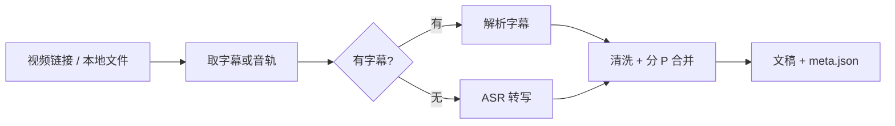

# Digital Garden

我做过的工具，和我读进去的东西。

不追求完整，只记录真正动手做过的、真正读完并留下的。

> 我做的事：把重复的手工流程，变成一条能自动跑通的链路。

---

## 精选作品

### vid-transcript

把视频变成可全文检索的文字稿。支持 B 站链接与本地文件，自动识别分 P，输出带时间戳的文稿与元信息。

**解决的问题**：长视频想回看某个观点，只能拖着进度条盲找。
**输入 → 输出**：一个链接 → 一份可搜索的 Markdown 文稿。

[查看全部工具 →](./tools/)

---

## 最近在读

留在这里的，一般是读完觉得"以后还会用到"的。不代表每篇都和我的工具相关。

| 标题 | 类型 | 来源 | 读完 | 为什么留下 |
|---|---|---|---|---|
| 待补充 | paper | — | — | — |

[查看完整阅读清单 →](./reading/)

---

全部工具

- **vid-transcript** —— 视频转文字稿，支持 B 站链接与本地文件
- 待补充

