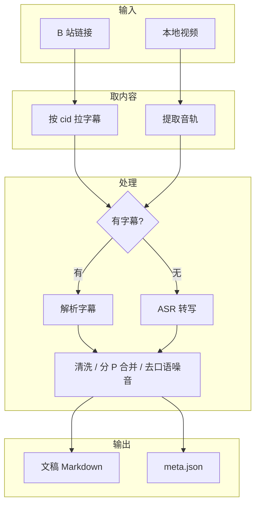

# vid-transcript

把视频变成可全文检索的文字稿。

[← 返回总目录](../README.md)

---

## 它解决什么

看完长视频，想回头找某个观点，只能拖着进度条盲找。把视频转成文字后，就能像搜文档一样搜视频。

## 框架

## 输入 → 输出

| 输入 | 输出 |
|---|---|
| 一个 B 站链接（可带 `?p=N`） | `output/<日期>_<简述>/` 下的文稿 + meta.json |
| 一个本地视频文件 | 同上，日期取文件修改时间 |

## 设计取舍

- **先找字幕，找不到才转写**：ASR 慢且会引入错字，有官方字幕时没必要付这个成本。
- **输出按"日期 + 简述"归档**：同一个视频重跑会复用原目录，避免产出散落一地。
- **清洗与转写分离**：换 ASR 引擎不影响清洗规则。

## 已知局限

- 依赖平台字幕接口，接口变动会直接失效。
- 多 P 视频要先确认是哪一集（同一内容常有带 BGM / 不带 BGM 两版）。

## 代码

[JustChenk/vid-transcript](https://github.com/JustChenk/vid-transcript)
