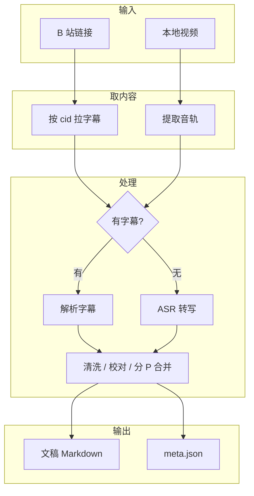

# vid-transcript

把视频变成可全文检索的文字稿。

[← 返回总目录](../README.md)

---

## 它解决什么

看完长视频，想回头找某个观点，只能拖着进度条盲找。把视频转成文字后，就能像搜文档一样搜视频。

## 框架

## 输入 → 输出

| 输入 | 输出 |
|---|---|
| 一个 B 站链接（可带 `?p=N`） | `output/<日期>_<简述>/` 下的文稿 + meta.json |
| 一个本地视频文件 | 同上，日期取文件修改时间 |

## 设计取舍

- **先找字幕，找不到才转写**：ASR 慢且会引入错字，有官方字幕时没必要付这个成本。
- **输出按"日期 + 简述"归档**：同一个视频重跑会复用原目录，避免产出散落一地。
- **清洗与转写分离**：换 ASR 引擎不影响清洗规则。
- **B 站走原生接口，其他平台走 yt-dlp**：原生接口能拿到 cid、分 P 这类平台特有字段；yt-dlp 覆盖 1755+ 站点，但字段是通用化的。两条链路各取所长。

## 踩坑记录

> 每条都对应仓库里的真实提交，括号内是提交号，可自行核对。

### 1. ASR 的两份结果，一份有标点没时间，一份有时间没标点

- **现象**：转出来的文稿要么完全没时间戳，要么句子被切成「自」+「动化」两行，读起来支离破碎
- **原因**：FunASR 返回两份结果——`text` 标点准但没有时间，`sentence_info` 时间准但标点按 VAD 分段乱加。两份粒度不同，直接累加对不齐；另外 `has_content` 把单字符空格误判成「有内容」，让两份输出差了 30 个字，对齐直接失败
- **解法**：按 `text` 的标点切句，用各片段贡献的字符数做归属对齐，取首尾时间；字符数对不上时用 difflib 兜底，相似度低于 0.9 才退回片段拼接（`6dbe0df`）

### 2. 依赖装完了，还是跑不起来

- **现象**：`pip install` 成功，执行时仍然无法识别
- **原因**：funasr 把 torch / torchaudio 标成可选依赖，pip 不会自动装
- **解法**：在 `requirements.txt` 和 `pyproject` 里显式声明，并写明 GPU 版 torch 的安装方式（`ee67acb`）

### 3. 换台机器就报找不到 ffmpeg

- **现象**：本地能跑，换台机器直接失败
- **原因**：直接调用系统 ffmpeg，等于把环境依赖转嫁给使用者
- **解法**：优先使用 imageio-ffmpeg 自带的二进制，不再强制系统安装（`88e4ba5`）

### 4. 指定第 N 集，抓到的是另一集

- **现象**：多 P 视频里选了第 N 集，字幕却来自别处
- **原因**：`p>1` 时仍然混用了 view 接口返回的字幕
- **解法**：字幕列表、音轨直链、时长、meta 全部按选中分 P 的 cid 取，`p>1` 时不再碰 view 接口字幕（`f6d0ac6`）

### 5. 跑几次之后，项目根目录堆满文稿和音频

- **现象**：输出散落在当前目录，临时音频也丢在项目根
- **原因**：输出没有归档设计，跑一次多一堆文件
- **解法**：统一归档到 `output/<日期>_<简述>/`；同一视频重跑复用目录（比对 meta.json 的 id），重名追加 `-2`；`output/` 进 `.gitignore`（`e66a1f3`）

### 6. 本地对齐得好好的流程图，推到 GitHub 就散架

- **现象**：靠制表符对齐的 ASCII 图，在 GitHub 和多数预览器里错位
- **原因**：等宽字体不一致，空格对齐必然崩
- **解法**：换成 Mermaid 由 GitHub 原生渲染；节点文字要用 `wrappingWidth` 调宽，否则会被挤成一行几个字（`a30cb7c`）

## 已知局限

- 抖音、微博等需要登录态的站点，必须额外传 `--cookies-from-browser`，否则拿不到内容。
- 多 P 视频必须显式指定 `?p=N` / `--page N`，否则无法确定要哪一集。
- 校对词典只对单个视频有效，不跨视频通用。

## 代码

[JustChenk/vid-transcript](https://github.com/JustChenk/vid-transcript)
